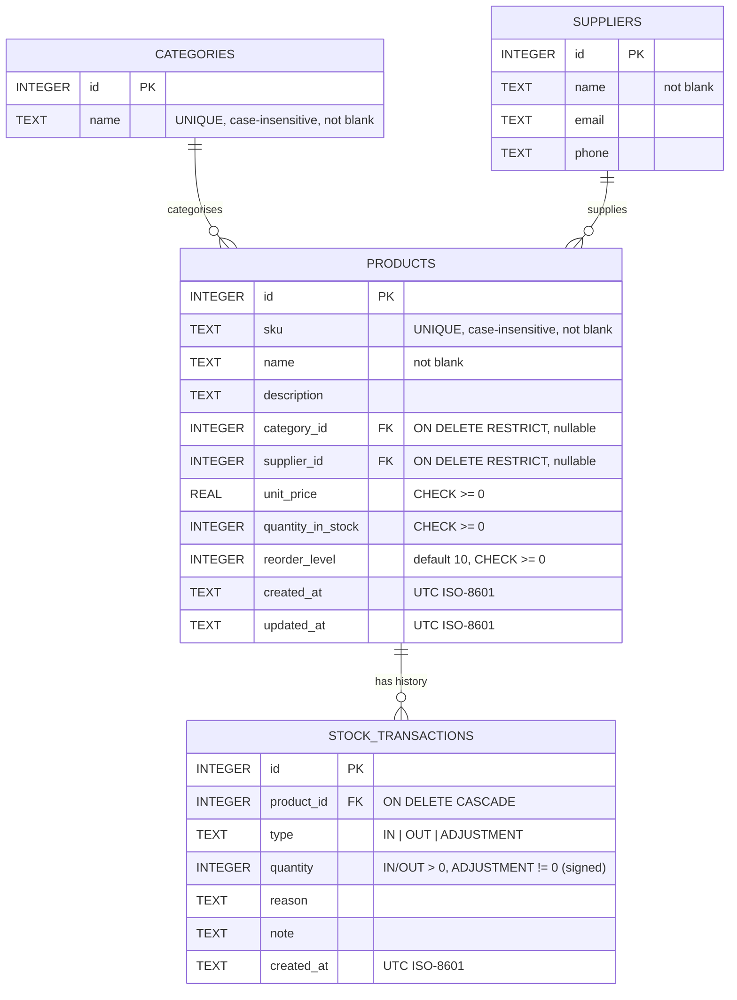

# Auspify IMS — Inventory Management System

A small but complete inventory system built as a teaching project:
**Python Flask** REST API + **SQLite** database + **React (Vite)** front end.

> Status: **complete** — Steps 0 to 5 built, tested and audited.
> 182 backend tests, 36 frontend tests, 213 live smoke checks and a 6-point
> data-integrity audit all pass. See [docs/TESTING.md](docs/TESTING.md).

---

## Contents

1. [Features](#1-features)
2. [Tech stack](#2-tech-stack)
3. [Folder structure](#3-folder-structure)
4. [Setup](#4-setup)
5. [Run](#5-run)
6. [Test & audit](#6-test--audit)
7. [Configuration](#7-configuration)
8. [Database design](#8-database-design)
9. [API reference](#9-api-reference)
10. [Design decisions](#10-design-decisions)
11. [Test & audit results](#11-test--audit-results)
12. [Suggested improvements](#12-suggested-improvements)
13. [Build history](#13-build-history)

---

## 1. Features

| Area | What you can do |
|------|-----------------|
| **Products** | Create, edit and delete products with SKU, name, description, category, supplier, unit price and reorder level. Duplicate SKUs (case-insensitive) and negative prices/quantities are rejected. |
| **Categories & suppliers** | Manage both lookups; a lookup that is still used by products cannot be deleted. |
| **Stock movements** | Stock **In**, Stock **Out** and **Adjust** (to a counted quantity or by a +/- delta). Stock can never go below zero. Every change writes an audit row — quantity update and audit row are saved in **one atomic transaction**. |
| **Stock status** | Automatic badges: *In stock*, *Low* (`quantity <= reorder_level`), *Out of stock* (`quantity = 0`). |
| **Search & filtering** | Search by name/SKU (partial, case-insensitive), filter by category, supplier, stock status and price range, sort any column both ways, paginate, "Clear filters", results count, empty-state message. Filters live in the URL so they survive reloads and can be shared. |
| **Reports** | Summary cards, inventory value by category (bar + pie), stock movements over a date range (line), top-moving products, low-stock table with shortfall, CSV export (formula-injection safe). |
| **Safety** | Validated input with per-field messages, parameterised SQL, whitelisted sort columns, size limits, security headers, CORS allow-list, no stack traces in responses. |

## 2. Tech stack

| Layer | Technology |
|-------|------------|
| Backend | Python 3.10+, Flask 3, Flask-CORS, `sqlite3` from the standard library (no ORM) |
| Database | SQLite with foreign keys, CHECK constraints and indexes |
| Frontend | React 19 (hooks), Vite 8, react-router-dom 7, Recharts 3, plain CSS, `fetch` |
| Testing | pytest, Vitest + Testing Library + jsdom, oxlint, a live HTTP smoke suite, pip-audit, npm audit |

## 3. Folder structure

```
auspify_ims/
├── README.md
├── docs/
│   └── TESTING.md                 # test guide, manual E2E checklist, edge cases
├── scripts/
│   └── smoke_test.py              # 213 live HTTP checks against a running backend
├── backend/
│   ├── app.py                     # create_app() factory, /api/health, security headers
│   ├── config.py                  # settings (env-overridable)
│   ├── schema.sql                 # tables, constraints, indexes
│   ├── database.py                # connections, transaction(), first-run setup
│   ├── seed.py                    # sample data (python seed.py --reset)
│   ├── errors.py                  # exception classes -> JSON error responses
│   ├── validation.py              # input parsing helpers (text, int, price, email)
│   ├── audit.py                   # data-integrity audit (read-only)
│   ├── models/                    # database layer - all SQL lives here
│   │   ├── products.py            #   CRUD + list_products() with filters/sort/pages
│   │   ├── categories.py
│   │   ├── suppliers.py
│   │   ├── stock.py               #   stock_in / stock_out / adjust_stock, history
│   │   └── reports.py             #   summary, low stock, valuation, movements, top moving
│   ├── routes/                    # HTTP layer - Flask blueprints, validation, status codes
│   │   ├── products.py
│   │   ├── categories.py
│   │   ├── suppliers.py
│   │   ├── stock.py
│   │   └── reports.py
│   ├── tests/                     # pytest suite (temporary database per test)
│   │   ├── conftest.py
│   │   ├── test_crud.py
│   │   ├── test_stock.py
│   │   ├── test_reports.py
│   │   ├── test_filters.py
│   │   └── test_security.py
│   ├── instance/inventory.db      # created on first run (git-ignored)
│   ├── pytest.ini
│   ├── requirements.txt
│   └── requirements-dev.txt
└── frontend/
    ├── index.html
    ├── vite.config.js             # dev server + /api proxy -> http://localhost:5000
    ├── package.json
    └── src/
        ├── main.jsx, App.jsx, App.css, index.css
        ├── api/client.js          # tiny fetch wrapper (JSON, errors)
        ├── hooks/useApi.js        # data loading hook with reload()
        ├── utils/format.js        # money/date/number formatting
        ├── components/
        │   ├── Navbar.jsx
        │   ├── ProductTable.jsx   # sortable headers, badges, empty message
        │   ├── ProductForm.jsx
        │   ├── ProductFilters.jsx # search/filter bar (+ DebouncedInput.jsx)
        │   ├── Pagination.jsx
        │   ├── LookupManager.jsx  # categories / suppliers CRUD
        │   ├── StockBadge.jsx
        │   ├── StockForm.jsx      # product picker + in/out/adjust
        │   ├── TransactionHistory.jsx
        │   ├── SummaryCards.jsx
        │   └── LowStockTable.jsx
        ├── pages/
        │   ├── Dashboard.jsx      # /
        │   ├── Products.jsx       # /products
        │   ├── StockMovements.jsx # /stock
        │   ├── Reports.jsx        # /reports
        │   └── Manage.jsx         # /manage
        └── test/                  # Vitest setup + fetch mock
```

## 4. Setup

Prerequisites: **Python 3.10+**, **Node.js 20.19+ (or 22.12+)** and npm.

```bash
git clone <this repository>
cd auspify_ims

# Backend
cd backend
python3 -m venv .venv
source .venv/bin/activate            # Windows: .venv\Scripts\activate
pip install -r requirements.txt      # Flask, Flask-CORS
pip install -r requirements-dev.txt  # + pytest, pip-audit (optional, for tests)

# Frontend (second terminal)
cd frontend
npm install
```

## 5. Run

```bash
# Terminal 1 - API on http://localhost:5000
cd backend
source .venv/bin/activate
python app.py

# Terminal 2 - UI on http://localhost:5173
cd frontend
npm run dev
```

Open <http://localhost:5173>.

- On first start the backend creates `backend/instance/inventory.db` from
  `schema.sql` and, because the database is empty, loads the sample data
  (6 categories, 4 suppliers, 22 products, ~160 movements).
- Start with an empty database: `IMS_AUTO_SEED=0 python app.py`.
- Reset the sample data at any time: `python seed.py --reset`.
- The Vite dev server proxies `/api/*` to Flask, so the browser never needs to
  know the backend address.

Quick check from the terminal:

```bash
curl http://localhost:5000/api/health
# {"status":"ok","service":"auspify-ims-backend"}
curl "http://localhost:5000/api/products?stock_status=low&per_page=3"
```

## 6. Test & audit

```bash
# Backend unit/integration tests (temporary DB, no server needed) - 182 tests
cd backend && source .venv/bin/activate && python -m pytest

# Data-integrity audit of the live database (exit code 0 = healthy)
python audit.py

# Frontend tests, lint, production build - 36 tests
cd frontend && npx vitest run && npm run lint && npm run build

# Live smoke suite (needs the backend running) - 213 checks
python3 scripts/smoke_test.py
python3 scripts/smoke_test.py --base http://localhost:5173   # through the Vite proxy

# Dependency vulnerability scans
cd backend && pip-audit -r requirements.txt
cd frontend && npm audit
```

The full guide — what each suite covers, the **manual end-to-end checklist**
and the **edge-case list** — is in [docs/TESTING.md](docs/TESTING.md).

## 7. Configuration

All settings live in `backend/config.py` and can be overridden with
environment variables:

| Variable | Default | Meaning |
|----------|---------|---------|
| `IMS_DATABASE` | `backend/instance/inventory.db` | SQLite file path |
| `IMS_AUTO_SEED` | `1` | Load sample data when the database is empty (`0` to disable) |
| `IMS_CORS_ORIGINS` | `http://localhost:5173,http://127.0.0.1:5173` | Browser origins allowed to call the API directly |
| `MAX_CONTENT_LENGTH` | 1 MB (code constant) | Largest accepted request body |

## 8. Database design



Key rules, enforced **by the database** as well as by the API:

- `PRAGMA foreign_keys = ON` on every connection, so orphan rows are impossible.
- Deleting a category/supplier that products use is refused (`RESTRICT`);
  deleting a product removes its history (`CASCADE`).
- `quantity_in_stock >= 0` and `unit_price >= 0` are CHECK constraints — the
  last line of defence behind the application's own checks.
- Indexes: `products(sku)` (via UNIQUE), `products(name)`, `products(category_id)`,
  `products(supplier_id)`, `stock_transactions(product_id)`, `stock_transactions(created_at)`.
- **Invariant:** for every product `quantity_in_stock = Σ IN − Σ OUT + Σ ADJUSTMENT`.
  Creating a product with an initial quantity writes an `IN` row ("Initial stock"),
  so the ledger is complete from day one. `audit.py` verifies this.

## 9. API reference

Base URL `http://localhost:5000`. All bodies and responses are JSON
(`Content-Type: application/json`). Ids in URLs must be integers in
`1 … 2^63−1`; anything else is a 404.

**Error shape** (every 4xx/5xx):

```json
{ "error": "Validation failed.", "details": { "unit_price": "Must be 0 or greater." } }
```

| Status | Meaning |
|--------|---------|
| 400 | Validation failed / insufficient stock / bad query parameter (`details` names each field) |
| 404 | Unknown id or route |
| 405 | Method not allowed |
| 409 | Conflict — duplicate SKU or category name, or lookup still in use |
| 413 | Request body larger than 1 MB |
| 500 | Unexpected error — generic message, details only in the server log |

### Health

| Method | Path | Returns |
|--------|------|---------|
| GET | `/api/health` | `{"status":"ok","service":"auspify-ims-backend"}` |

### Products

| Method | Path | Body / query | Returns |
|--------|------|--------------|---------|
| GET | `/api/products` | `search`, `category`, `supplier`, `stock_status` (`in_stock`/`low`/`out`), `min_price`, `max_price`, `sort` (`name`, `sku`, `unit_price`, `quantity_in_stock`, `reorder_level`, `category`, `supplier`, `created_at`, `updated_at`), `order` (`asc`/`desc`), `page` (≥1), `per_page` (1–100, default 20) | `{items, total, page, per_page, total_pages, sort, order}` |
| POST | `/api/products` | `{sku*, name*, unit_price*, description?, category_id?, supplier_id?, reorder_level? (10), quantity_in_stock? (0)}` | 201 product |
| GET | `/api/products/<id>` | — | product (with `category_name`, `supplier_name`, `stock_status`) |
| PUT | `/api/products/<id>` | any subset of the create fields **except** `quantity_in_stock` | product |
| DELETE | `/api/products/<id>` | — | 204 (history deleted too) |
| GET | `/api/products/<id>/transactions` | `limit` (1–500, default 100) | `{items: [...]}` newest first |

Product fields: `sku` 1–50 chars of `A-Z a-z 0-9 . _ -`; `name` ≤ 100 chars;
`description` ≤ 1000 chars; `unit_price` 0 – 1 000 000 000, rounded half-up to
2 dp (strings must be plain decimals such as `"12.50"`); quantities and reorder
level 0 – 1 000 000 000. Invalid query parameters are rejected with 400, never
silently ignored.

### Categories & suppliers

| Method | Path | Body | Returns |
|--------|------|------|---------|
| GET | `/api/categories` | — | `{items: [{id, name, product_count}], total}` |
| POST | `/api/categories` | `{name*}` | 201 category (409 if the name exists, case-insensitive) |
| GET / PUT / DELETE | `/api/categories/<id>` | PUT: `{name}` | category / category / 204 (409 if products use it) |
| GET | `/api/suppliers` | — | `{items: [{id, name, email, phone, product_count}], total}` |
| POST | `/api/suppliers` | `{name*, email?, phone?}` | 201 supplier |
| GET / PUT / DELETE | `/api/suppliers/<id>` | PUT: any subset | supplier / supplier / 204 (409 if products use it) |

### Stock movements

| Method | Path | Body / query | Returns |
|--------|------|--------------|---------|
| POST | `/api/stock/in` | `{product_id*, quantity* (>0), reason?, note?}` | 201 `{transaction, product}` |
| POST | `/api/stock/out` | `{product_id*, quantity* (>0), reason?, note?}` | 201 `{transaction, product}` — 400 `Insufficient stock for SKU: requested X, only N available.` if it would go below zero |
| POST | `/api/stock/adjust` | `{product_id*, new_quantity | delta (exactly one), reason?, note?}` | 201 `{transaction, product}`; the ADJUSTMENT row stores the signed difference |
| GET | `/api/stock/transactions` | `limit` (1–500, default 50) | `{items: [...]}` across all products, newest first |

### Reports

| Method | Path | Query | Returns |
|--------|------|-------|---------|
| GET | `/api/reports/summary` | — | `{total_products, total_units, total_value, low_stock_count, out_of_stock_count, total_categories, total_suppliers, total_transactions}` |
| GET | `/api/reports/low-stock` | `format=csv` for a download | `{items: [{…product, shortfall, stock_status}], total}` ordered most urgent first |
| GET | `/api/reports/valuation-by-category` | `format=csv` | `{items: [{category_id, category_name, product_count, total_units, total_value}], total_value}` |
| GET | `/api/reports/movements` | `from`, `to` (`YYYY-MM-DD`, default last 30 days, max 366 days) | `{from, to, days: [{day, stock_in, stock_out, adjustments, transactions, net}], totals}` — every day in the range is present, zero-filled |
| GET | `/api/reports/top-moving-products` | `from`, `to`, `limit` (1–50, default 5) | `{from, to, items: [{id, sku, name, category_name, units_out, units_in, transactions, quantity_in_stock}]}` |

CSV exports send `Content-Disposition: attachment` and prefix any cell starting
with `=`, `+`, `-`, `@`, tab or CR with `'` so spreadsheets treat it as text.

### Examples

```bash
# Create a product with 20 units (writes an IN transaction automatically)
curl -X POST localhost:5000/api/products -H 'Content-Type: application/json' \
  -d '{"sku":"ELEC-999","name":"USB Hub","unit_price":49.9,"quantity_in_stock":20,"reorder_level":5}'

# Sell 3 units
curl -X POST localhost:5000/api/stock/out -H 'Content-Type: application/json' \
  -d '{"product_id":1,"quantity":3,"reason":"Sale"}'

# Low-stock electronics under GH₵100, cheapest first, page 1 of 10
curl "localhost:5000/api/products?category=1&stock_status=low&max_price=100&sort=unit_price&per_page=10"

# Movements for October 2026
curl "localhost:5000/api/reports/movements?from=2026-10-01&to=2026-10-31"
```

## 10. Design decisions

- **Separate layers.** `routes/` only parse, validate and choose status codes;
  `models/` contain every SQL statement; `database.py` owns connections and
  transactions. A beginner can read one layer at a time.
- **Stock changes only through the stock endpoints.** `PUT /api/products/<id>`
  rejects `quantity_in_stock`, which guarantees the audit trail is complete.
- **Atomic movements.** `with transaction(conn):` wraps the `UPDATE` and the
  audit `INSERT` in a single `BEGIN IMMEDIATE … COMMIT`; any exception rolls
  both back. `BEGIN IMMEDIATE` also serialises concurrent writers.
- **Guard in SQL, not in Python.** `UPDATE … WHERE quantity_in_stock >= ?`
  makes the "never below zero" check race-free; the CHECK constraint backs it up.
- **Fail loudly on bad input.** Unknown sort columns, typos in `stock_status`,
  non-numeric prices and so on return 400 with the field named, instead of
  being ignored and silently returning the wrong data.
- **Reports are computed by SQLite from the raw tables** — nothing is cached or
  denormalised, so they can never drift from the data. `audit.py` double-checks
  the key totals independently in Python.
- **Filters live in the URL** on the Products page, so the back button, reloads
  and shared links all work; the search box is debounced (300 ms).
- **Money.** Prices are parsed with `Decimal` and rounded half-up to 2 dp,
  stored as REAL, and formatted on the client.

## 11. Test & audit results

Latest full run (all on the final commit):

| Suite | Command | Result |
|-------|---------|--------|
| Backend pytest | `python -m pytest` | **182 passed** in 5.4 s |
| Frontend Vitest | `npx vitest run` | **36 passed** (5 files) |
| Lint | `npm run lint` | 0 warnings, 0 errors |
| Production build | `npm run build` | OK |
| Live smoke suite | `scripts/smoke_test.py` (direct and via `:5173` proxy) | **213 passed, 0 failed** ×2 |
| Data-integrity audit | `python audit.py` | **ALL CHECKS PASSED (6/6)** — 22 products, 161 transactions, value 96 129.00 |
| Audit on a corrupted copy | `python audit.py /tmp/corrupt.db` | 4 checks failed, every injected fault listed, exit 1 |
| Mutation check | rollback removed / oversell guard removed | each caught by a failing test |
| Dependency scan | `pip-audit`, `npm audit` | 0 known vulnerabilities |

Full details, the manual E2E checklist and the edge-case matrix:
[docs/TESTING.md](docs/TESTING.md).

## 12. Suggested improvements

| Improvement | Notes |
|-------------|-------|
| **Login & roles** | Add a `users` table, password hashing (`werkzeug.security`), session or JWT auth, and roles such as *viewer* / *clerk* / *manager* (only managers adjust stock or delete products). Record `user_id` on every `stock_transactions` row. |
| **Barcode / QR scanning** | SKU is already barcode-friendly. Add a scanner input on Stock Movements (keyboard-wedge scanners type the code + Enter) and label printing from the product page. |
| **Purchase orders** | `purchase_orders` + `purchase_order_lines` tables; receiving a PO creates the `IN` transactions; suggested orders from the low-stock report (`shortfall` × pack size). |
| **Email / low-stock alerts** | Nightly job (APScheduler or cron calling an endpoint) that emails the low-stock CSV; `audit.py` can run in the same job and alert on discrepancies. |
| **Docker** | Two-stage image: build the frontend with Node, serve `dist/` with Flask or nginx; mount a volume for `instance/`. `docker compose up` for one-command start. |
| **Production hardening** | Run behind gunicorn, move to PostgreSQL via a thin adapter in `database.py`, add rate limiting, structured logging and request ids. |
| **Nice-to-haves** | Soft delete / archive products, multi-location stock, import products from CSV, dark mode, server-side rate limiting on search. |

## 13. Build history

| Step | Commit | Scope |
|------|--------|-------|
| 0 | `2b299dd` | Project skeleton, `/api/health`, Vite proxy |
| 1 | `a98c4c8` | Schema, seed data, validation and error layers, CRUD for products/categories/suppliers (API + UI), smoke suite |
| 2 | `db41faa` | Stock in/out/adjust with atomic audit trail, stock status badges, transaction history |
| 3 | `65d2668` | Reports API, dashboard and reports pages with charts and CSV export |
| 4 | `d06eb32` | Search, filters, sorting, pagination (API + UI); stock picker made search-driven |
| 5 | `ff63a21` | pytest suite, security tests, data-integrity audit, stricter price parsing |
| — | `6db3f12` | Final README and testing guide |
